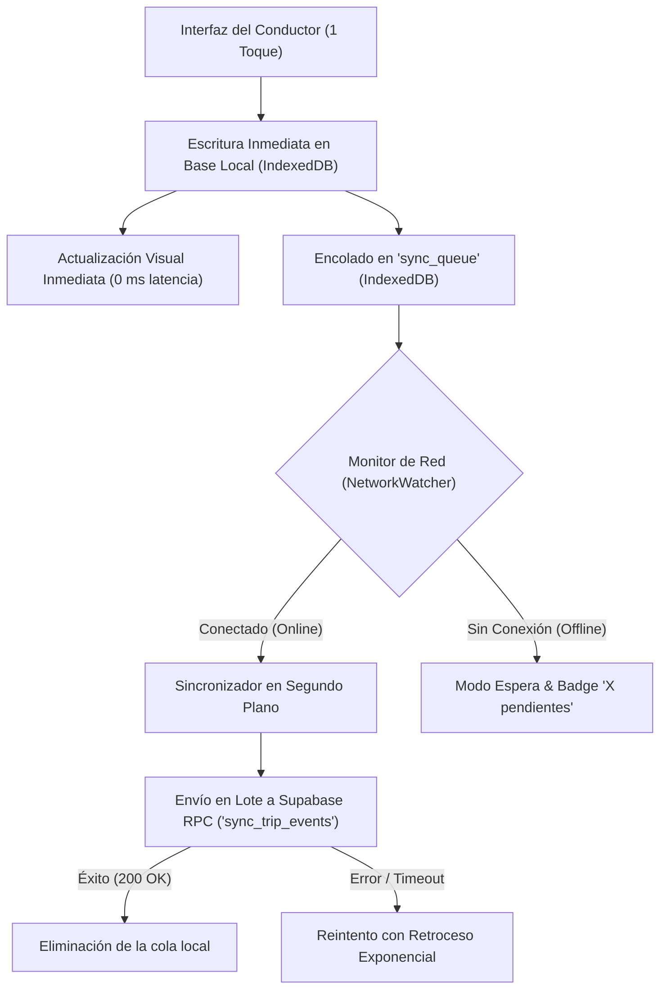
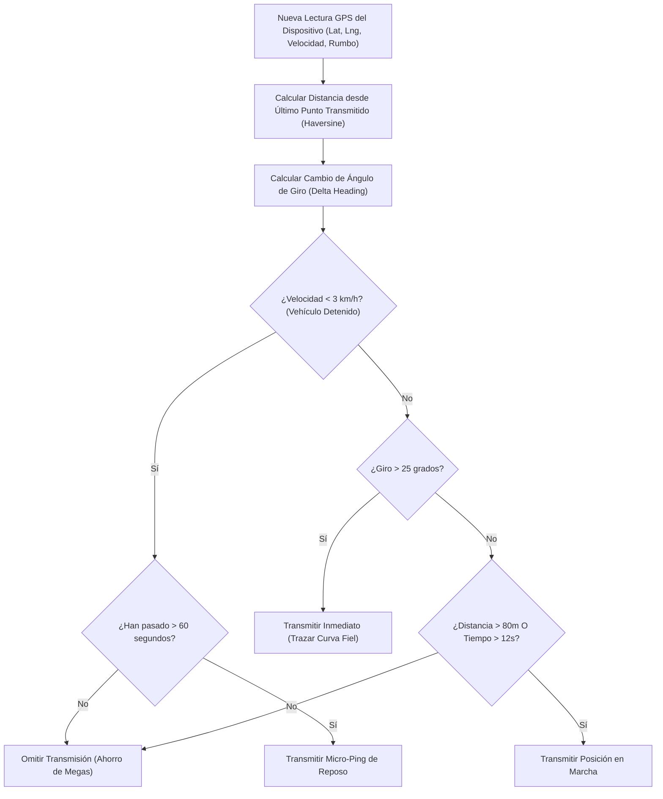
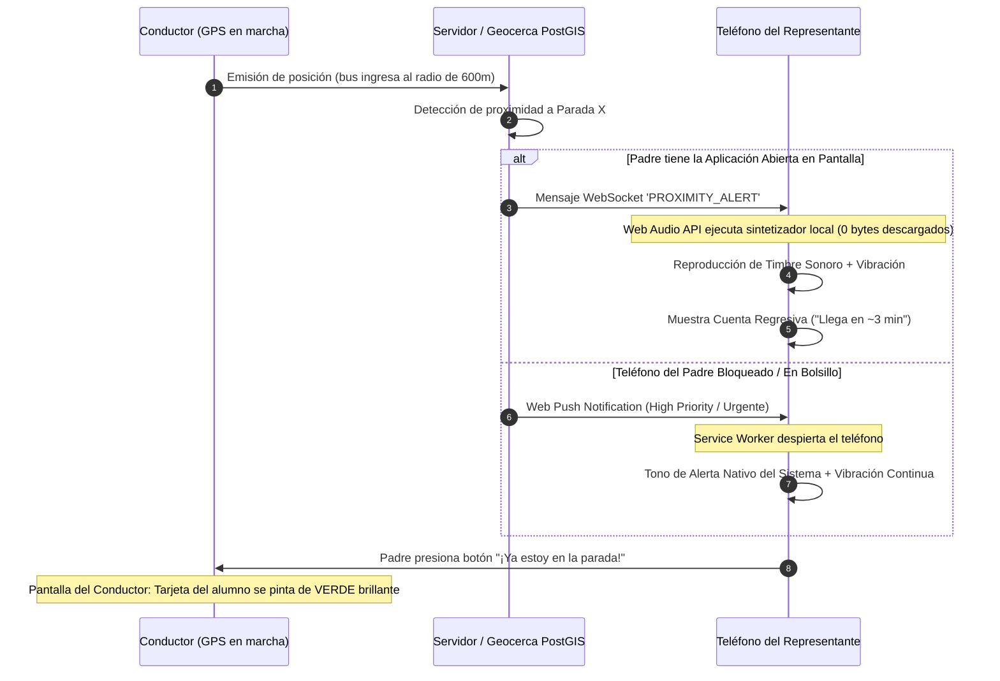
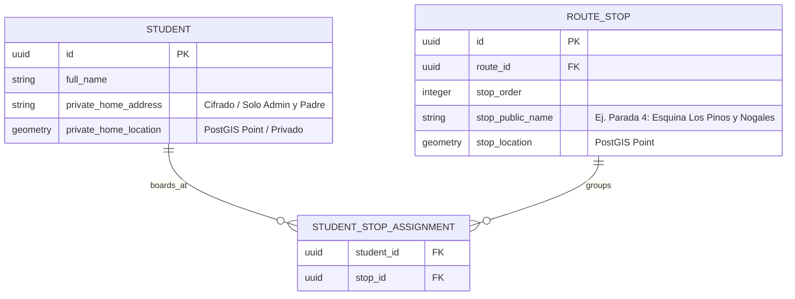

# INFORME TÉCNICO DE DISEÑO ARQUITECTÓNICO RESILIENTE
## Plataforma SaaS de Transporte Escolar Multiinstitucional
### Resolución Integral de las Tensiones Técnicas: Operatividad Offline, Ahorro de Megas, Alertas Sonoras y Privacidad de Menores

> **Autor:** Arquitecto Principal de Software & Senior Technical Lead  
> **Fecha:** Octubre 2026  
> **Destinatario:** Equipo de Dirección y Desarrollo  
> **Propósito:** Definir con rigor de ingeniería la arquitectura, algoritmos, flujo de datos y experiencia de usuario (UX) para resolver las 4 tensiones técnicas operativas antes de escribir la primera línea de código.

---

## 1. RESUMEN EJECUTIVO DEL DISEÑO

El éxito de una aplicación de transporte escolar en América Latina no se decide en condiciones ideales de laboratorio con conexión de fibra óptica 5G; se decide en las periferias urbanas y valles, donde:
1. La señal celular de los operadores (Claro, Movistar, Tuenti) sufre micro-cortes o desvanecimientos repentinos.
2. Los conductores y muchos padres de familia recargan **paquetes prepago de datos móviles** limitados ($1 o $2 por 200 MB – 500 MB).
3. Los conductores no pueden distraerse operando interfaces complejas mientras conducen.
4. La impuntualidad de los representantes al salir a la parada genera un "efecto dominó" de retrasos en toda la ruta.
5. Los datos de ubicación y domicilios de los niños están amparados por legislaciones estrictas de protección de datos (LOPDP Ecuador, Art. 25).

A continuación se detalla el diseño técnico específico para cada subsistema.

---

## 2. RESOLUCIÓN DE LA TENSIÓN 1: MODO OFFLINE Y RESILIENCIA DE DATOS
### *¿Cómo garantizar la continuidad operativa del conductor sin internet y mantener informados a los padres?*

### 2.1. Arquitectura Local Offline-First del Conductor (IndexedDB + Cola Transaccional)

El dispositivo del conductor no realiza peticiones HTTP directas y bloqueantes para sus operaciones de ruta. En su lugar, implementa el patrón **Local-First with Outbox Pattern**:



#### Estructura de la Base de Datos Local en el Dispositivo (IndexedDB - Store: `transporte_local_db`):
1. **`trip_manifest`**: Padrón precargado del viaje actual (estudiantes, paradas, orden, direcciones de referencia y teléfonos de emergencia). Permite operar 100% desconectado.
2. **`attendance_records`**: Estado actual de cada estudiante (`pending`, `boarded`, `dropped_off`, `absent`).
3. **`sync_queue`**: Registro de eventos pendientes de envío al servidor:
   ```typescript
   interface SyncQueueItem {
     id: string; // UUID v4 generado en cliente
     action: 'BOARD_STUDENT' | 'DROP_STUDENT' | 'MARK_ABSENT' | 'REPORT_INCIDENT' | 'BATCH_TELEMETRY';
     payload: Record<string, any>;
     client_timestamp: string; // ISO 8601 exacto del momento del clic
     retry_count: number;
     status: 'pending' | 'syncing' | 'failed';
   }
   ```

### 2.2. Manejo de Conflictos y Transacciones Idempotentes en Supabase
Para evitar duplicados si la conexión se corta a mitad de una petición HTTP, el backend expone un procedimiento almacenado PostgreSQL **idempotente**:
- Cada evento enviado incluye un `client_event_id` (UUID).
- Si el servidor ya procesó ese UUID, no lo duplica ni sobreescribe erróneamente; simplemente responde `HTTP 200 { status: 'already_applied' }`.
- La hora registrada para la asistencia es siempre `client_timestamp` (la hora real en que el niño subió al bus), evitando que se registre la hora en que el conductor recuperó la señal 15 minutos más tarde.

### 2.3. Experiencia de Usuario para los Padres durante la Desconexión del Bus
Si el bus pierde cobertura durante el recorrido:
- El mapa del padre **no se congela sin explicación** ni borra el vehículo.
- El marcador del bus entra en modo **"Atenuado / Semitransparente"** con un indicador visual amigable:
  > 📡 *"El transporte se encuentra en una zona con baja señal celular. Última parada registrada: Los Pinos (07:14 AM). La ruta continúa su curso normal."*
- Tan pronto el bus recupera cobertura, los puntos acumulados se sincronizan y el estado del mapa se actualiza automáticamente.

---

## 3. RESOLUCIÓN DE LA TENSIÓN 2: AHORRO EXTREMO DE MEGAS PREPAGO
### *¿Cómo ofrecer rastreo GPS en vivo sin agotar los paquetes de datos móviles de \$1 o \$2?*

### 3.1. Comparativa de Consumo: Arquitectura Estándar vs. Arquitectura Optimizada

| Parámetro | Enfoque Tradicional (Ingenuo) | Nuestro Enfoque Optimizado (Dead Reckoning + Compact) |
| :--- | :--- | :--- |
| **Protocolo de envío** | Peticiones HTTP POST cada 2 segundos | Canal WebSocket (Supabase Realtime) con emisión adaptativa |
| **Cabeceras por envío** | ~800 bytes (TLS, Cookies, Headers HTTP) | 0 bytes adicionales (Canal TCP/TLS ya abierto) |
| **Formato del Payload** | JSON verboso (~250 bytes) | Array compacto o micro-JSON (~45 bytes) |
| **Frecuencia detenido** | Cada 2 segundos inútilmente | 1 ping cada 60 segundos (modo reposo) |
| **Frecuencia en marcha** | Cada 2 segundos fijo | Cada 10-12s en línea recta / Inmediato ante giros (>25°) |
| **Consumo por hora** | **~20 MB a 35 MB por recorrido** | **~0.8 MB a 1.5 MB por recorrido** |
| **Consumo mensual (40 viajes)** | **~1.2 GB a 1.4 GB (Agotaría plan prepago)** | **~45 MB a 60 MB (Dentro de cualquier paquete mínimo)** |

### 3.2. Algoritmo de Muestreo Adaptativo en el Teléfono del Conductor

El teléfono ejecuta un bucle inteligente que evalúa 3 variables físicas antes de decidir transmitir:



### 3.3. Estructura del Micro-Payload
En lugar de transmitir objetos pesados con nombres de propiedades repetidos:
```json
// EVITADO (Innecesariamente pesado: 248 bytes por punto)
{
  "organization_id": "9b1deb4d-3b7d-4bad-9bdd-2b0d7b3dcb6d",
  "trip_id": "e4eaaaf2-d142-11e1-b3e4-080027620cdd",
  "latitude": -0.180653,
  "longitude": -78.467834,
  "speed_kilometers_per_hour": 34.5,
  "heading_degrees": 182.4,
  "timestamp": "2026-10-15T19:25:00.000Z"
}
```

Se transmite un formato ultraligero a través del canal en vivo:
```json
// IMPLEMENTADO (Compacto: 52 bytes)
[-0.180653, -78.467834, 34.5, 182, 1729020300]
// [lat, lng, km/h, rumbo, timestamp_unix_segundos]
```
En el servidor o en los clientes receptores, una función decodificadora ligera mapea el array a las variables de visualización.

---

## 4. RESOLUCIÓN DE LA TENSIÓN 3: ALERTA SONORA Y UX ANTI-IMPUNTUALIDAD
### *¿Cómo lograr que el padre salga a tiempo sin retrasar la ruta del bus?*

Uno de los mayores dolores de cabeza en el transporte escolar es el conductor esperando 3 a 5 minutos en cada casa porque el estudiante o el padre no están listos. Si esto ocurre en 10 paradas, la ruta acumula **40 minutos de retraso**.

### 4.1. Arquitectura de Dos Canales para la Alerta Sonora ("Timbre")



### 4.2. Generación del Timbre Sonoro con Cero Consumo de Megas (Web Audio API)
Para no obligar al teléfono del padre a descargar archivos MP3 de audio cada vez que se usa la app (lo que gastaría megas y fallaría si tiene mala señal), el sonido del timbre se **sintetiza matemáticamente en el navegador** en tiempo de ejecución:

```typescript
// Sintetizador de Timbre Escolar con Web Audio API (Cero descargas de red)
export function playSchoolChime(): void {
  try {
    const audioCtx = new (window.AudioContext || (window as any).webkitAudioContext)();
    const now = audioCtx.currentTime;
    
    // Tono 1: Campana alta (880 Hz - Nota La5)
    const osc1 = audioCtx.createOscillator();
    const gain1 = audioCtx.createGain();
    osc1.type = 'sine';
    osc1.frequency.setValueAtTime(880, now);
    gain1.gain.setValueAtTime(0.3, now);
    gain1.gain.exponentialRampToValueAtTime(0.001, now + 0.8);
    osc1.connect(gain1);
    gain1.connect(audioCtx.destination);
    
    // Tono 2: Resonancia cálida (587.33 Hz - Nota Re5 con delay de 150ms)
    const osc2 = audioCtx.createOscillator();
    const gain2 = audioCtx.createGain();
    osc2.type = 'triangle';
    osc2.frequency.setValueAtTime(587.33, now + 0.15);
    gain2.gain.setValueAtTime(0.4, now + 0.15);
    gain2.gain.exponentialRampToValueAtTime(0.001, now + 1.2);
    osc2.connect(gain2);
    gain2.connect(audioCtx.destination);

    osc1.start(now);
    osc1.stop(now + 0.8);
    osc2.start(now + 0.15);
    osc2.stop(now + 1.2);
  } catch (e) {
    console.warn('Audio autoplay restringido o no soportado', e);
  }
}
```

### 4.3. Flujo UX Anti-Impuntualidad ("Protocolo de 3 Fases")

```text
[FASE 1: PRE-AVISO] (Distancia: ~1.2 km / ~6 min estimados)
- Notificación silenciosa en teléfono: "El transporte escolar ha iniciado su aproximación a tu sector."
- Estado del alumno en la app: "En espera".

[FASE 2: ALERTA ACTIVA Y TIMBRE] (Distancia: ~500 metros / ~3 min estimados)
- Se activa el TIMBRE SONORO (chime) y vibración en el teléfono.
- La pantalla muestra una cuenta regresiva dinámica en color amarillo de advertencia:
  ┌────────────────────────────────────────────────────────┐
  │ ⏰ EL TRANSPORTE LLEGA EN: 02:45 min                   │
  │ Por favor, sal con Mateo a la puerta ahora.           │
  │                                                        │
  │ [  🟢 ¡YA ESTAMOS EN LA PARADA!  ]  <-- BOTÓN GIGANTE  │
  └────────────────────────────────────────────────────────┘

[FASE 3: CONFIRMACIÓN DEL CONDUCTOR]
- Si el padre pulsa "¡Ya estamos en la parada!":
  El conductor ve en su pantalla la tarjeta del alumno con un borde VERDE destellante. Sabe que el niño ya está en la vereda y frena con seguridad.
- Si el conductor llega a la parada y el padre NO ha pulsado el botón:
  La app del conductor inicia un temporizador de cortesía de 60 segundos. Si expira, se habilita el botón de 1 toque: "Reportar Ausencia / Inasistencia" con notificación inmediata al colegio y al padre, deslindando responsabilidad al conductor.
```

---

## 5. RESOLUCIÓN DE LA TENSIÓN 4: GESTIÓN DE DOMICILIOS Y PRIVACIDAD DE MENORES (LOPDP ECUADOR)
### *¿Cómo ubicar exactamente la parada de cada alumno sin exponer la intimidad de los menores a terceros?*

El Art. 25 de la Ley Orgánica de Protección de Datos Personales de Ecuador considera la información de niños y adolescentes como **datos de categoría especial**. Exponer en un mapa público o grupal las direcciones donde viven todos los niños de un curso constituye una vulneración legal severa.

### 5.1. Abstracción Arquitectónica: Domicilio Privado vs. Parada Operativa

Diseñamos una separación estricta entre la **vivienda privada** del alumno y la **parada de ruta**:



### 5.2. Reglas de Visibilidad en el Mapa por Rol (Control de Acceso PostGIS + RLS)

| Actor | Lo que VE en el mapa | Lo que TIENE BLOQUEADO por RLS |
| :--- | :--- | :--- |
| **Administrador del Colegio** | Todos los domicilios, paradas, rutas y unidades. | Nada (sujeto a logs de auditoría por consulta). |
| **Conductor Asignado** | Las paradas secuenciales de su ruta, nombres de los niños a recoger en esa parada y referencias visuales ("Portón blanco"). | Las direcciones de alumnos de otras rutas o colegios. |
| **Representante Legal (Padre A)** | **Únicamente la ubicación de su propio hijo/parada** y el icono del bus en movimiento. | **TOTALMENTE BLOQUEADO:** No ve las paradas de los demás niños, no ve las casas de los demás niños y no ve los nombres de los otros pasajeros en el mapa. |

---

## 6. DISEÑO DE INTERFAZ DE USUARIO (UX) PARA LA OPERACIÓN EN RUTA

La interfaz del conductor está diseñada para ser operada **con una sola mano**, montada en el tablero del bus, con **botones táctiles grandes (>56px de alto)** y alto contraste para legibilidad bajo luz solar directa.

### 6.1. Mockup Conceptual: Consola de Conductor en Marcha (HU-03)

```text
┌────────────────────────────────────────────────────────┐
│ 🚸 RUTA 04 - MAÑANA          [🟢 EN LÍNEA | 3 en cola] │
│ 📍 PRÓXIMA PARADA: Av. Ilaló y Calle 3      07:18 AM   │
├────────────────────────────────────────────────────────┤
│ ESTUDIANTES EN ESTA PARADA (2):                        │
│                                                        │
│ ┌────────────────────────────────────────────────────┐ │
│ │ 👦 Mateo Carrillo (5to EGB)   [🟢 PADRE EN PARADA] │ │
│ │   Ref: Casa esquinera portón negro                 │ │
│ │                                                    │ │
│ │  [ 🟢 A BORDO ]     [ 🟡 AUSENTE ]   [ 📞 LLAMAR ] │ │
│ └────────────────────────────────────────────────────┘ │
│                                                        │
│ ┌────────────────────────────────────────────────────┐ │
│ │ 👧 Valentina Morales (3ro EGB)                     │ │
│ │   Ref: Junto a Farmacia SanaSana                   │ │
│ │                                                    │ │
│ │  [ 🟢 A BORDO ]     [ 🟡 AUSENTE ]   [ 📞 LLAMAR ] │ │
│ └────────────────────────────────────────────────────┘ │
├────────────────────────────────────────────────────────┤
│ RESUMEN: 12 A bordo | 3 Pendientes | 1 Ausente        │
│ [ ⚠️ REPORTAR INCIDENCIA (TRÁFICO/DESVÍO) ]            │
└────────────────────────────────────────────────────────┘
```

* **Un solo toque para confirmar:** Con un toque en `[ 🟢 A BORDO ]`, el alumno pasa a bordo instantáneamente (se guarda en IndexedDB en 0 ms) y la tarjeta se contrae para dejar espacio al siguiente.
* **Sin distracciones:** No hay menús desplegables complejos ni teclados virtuales obligatorios mientras el vehículo está en marcha.

---

## 7. ESQUEMA DE BASE DE DATOS INICIAL DEFINITIVO (MIGRACIÓN SQL)

Para plasmar de inmediato esta arquitectura, se estructuran las siguientes tablas nucleares en PostgreSQL con PostGIS y RLS:

```sql
-- 1. EXTENSIÓN POSTGIS PARA COORDENADAS Y GEOCERCAS
CREATE EXTENSION IF NOT EXISTS postgis;

-- 2. TABLA DE ESTUDIANTES CON DIRECCIONES Y COORDENADAS
CREATE TABLE public.students (
    id UUID PRIMARY KEY DEFAULT gen_random_uuid(),
    school_id UUID NOT NULL REFERENCES public.organizations(id) ON DELETE CASCADE,
    first_name VARCHAR(80) NOT NULL,
    last_name VARCHAR(80) NOT NULL,
    identification_number VARCHAR(20),
    grade_level VARCHAR(40) NOT NULL,
    home_address TEXT NOT NULL,
    home_location GEOMETRY(Point, 4326) NOT NULL,
    emergency_phone VARCHAR(20) NOT NULL,
    medical_notes TEXT,
    status VARCHAR(20) DEFAULT 'active' CHECK (status IN ('active', 'inactive')),
    created_at TIMESTAMPTZ DEFAULT NOW(),
    updated_at TIMESTAMPTZ DEFAULT NOW()
);

-- 3. ÍNDICE GEOESPACIAL PARA CÁLCULO VELOZ DE PROXIMIDAD
CREATE INDEX idx_students_home_location ON public.students USING GIST (home_location);

-- 4. TABLA DE PARADAS DE RUTA
CREATE TABLE public.route_stops (
    id UUID PRIMARY KEY DEFAULT gen_random_uuid(),
    route_id UUID NOT NULL REFERENCES public.routes(id) ON DELETE CASCADE,
    stop_order INTEGER NOT NULL,
    name VARCHAR(100) NOT NULL,
    location GEOMETRY(Point, 4326) NOT NULL,
    address_reference TEXT,
    scheduled_time TIME NOT NULL,
    geofence_radius_meters INTEGER DEFAULT 500, -- Radio para disparar el timbre sonoro
    UNIQUE(route_id, stop_order)
);

CREATE INDEX idx_route_stops_location ON public.route_stops USING GIST (location);

-- 5. TABLA DE ASISTENCIA Y ABORDAJE A BORDO (OPTIMIZADA PARA OFFLINE)
CREATE TABLE public.student_trip_logs (
    id UUID PRIMARY KEY DEFAULT gen_random_uuid(),
    client_event_id UUID UNIQUE, -- ID para garantizar idempotencia en sincronización
    trip_id UUID NOT NULL REFERENCES public.trips(id) ON DELETE CASCADE,
    student_id UUID NOT NULL REFERENCES public.students(id) ON DELETE CASCADE,
    stop_id UUID REFERENCES public.route_stops(id),
    status VARCHAR(20) DEFAULT 'pending' CHECK (status IN ('pending', 'boarded', 'dropped_off', 'absent', 'excused')),
    recorded_at TIMESTAMPTZ NOT NULL, -- Marca de tiempo real en que el conductor hizo clic
    synced_at TIMESTAMPTZ DEFAULT NOW(), -- Marca de tiempo en que llegó al servidor
    recorded_by_driver_id UUID REFERENCES public.drivers(id),
    parent_acknowledged BOOLEAN DEFAULT FALSE, -- Si el padre marcó 'Estoy en la parada'
    notes TEXT
);

CREATE INDEX idx_trip_logs_trip_status ON public.student_trip_logs (trip_id, status);
```

---

## 8. CONCLUSIÓN Y SIGUIENTE PASO

Este diseño arquitectónico garantiza que:
1. La aplicación **nunca se cuelgue ni bloquee** al conductor en zonas sin señal de internet.
2. Un recorrido completo de 1 hora consuma **menos de 2 MB de datos**, protegiendo los planes prepago.
3. El **timbre sonoro automático** y la mecánica UX anti-impuntualidad reduzcan drásticamente las demoras en cada parada.
4. Las direcciones y datos de los menores cumplan rigurosamente la ley de protección de datos de Ecuador.
